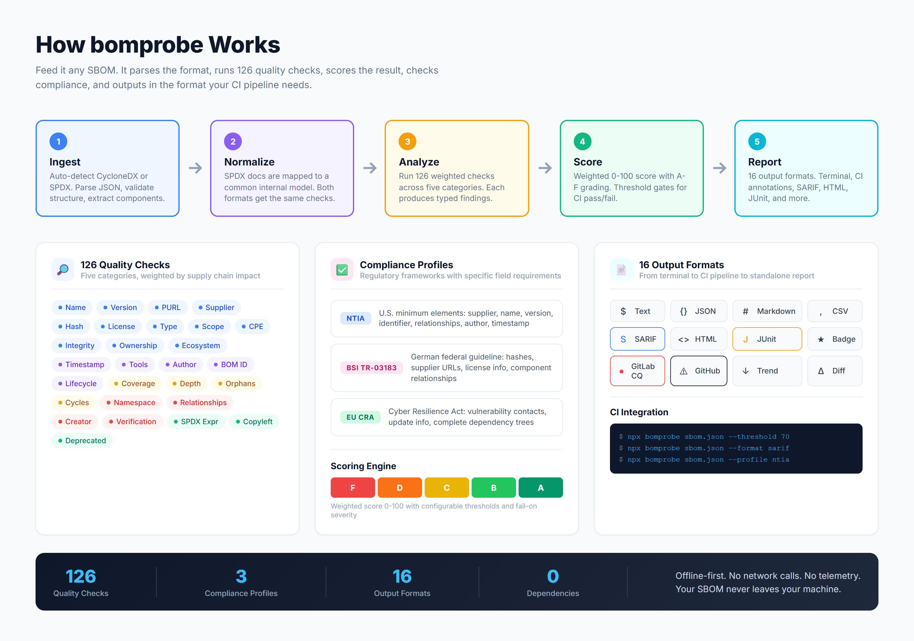

<div align="center">

# bomprobe

**Know your SBOM before your auditor does.**

140 quality checks across CycloneDX and SPDX, three compliance profiles,
16 output formats, zero dependencies. Scores your software bill of materials
on a 0-100 scale and tells you exactly what to fix.

[](https://github.com/aks-builds/bomprobe/actions/workflows/ci.yml)
[](https://www.npmjs.com/package/bomprobe)
[](https://pypi.org/project/bomprobe/)
[](#checks)
[](LICENSE)
[](https://nodejs.org)
[](#)

</div>

---

[](/.github/media/how-it-works.png)

## Why bomprobe

SBOM generators produce output. bomprobe tells you if that output is any good.

Most teams generate a CycloneDX or SPDX file, check the box, and move on. But regulators
(EU CRA, NTIA, BSI TR-03183) expect specific fields to be present, and downstream consumers
(Dependency-Track, GUAC, Grype) produce better results when the BOM is complete. bomprobe
catches what your generator missed before it reaches production.

It runs entirely offline, has zero npm dependencies, and works as a CLI, CI quality gate,
or Node.js library.

## Install

```bash
npm install -g bomprobe
```

Or run without installing:

```bash
npx bomprobe sbom.json
```

Or use as a project dependency:

```bash
npm install --save-dev bomprobe
```

## Quick start

```bash
# Score an SBOM
bomprobe sbom.json

# Check NTIA minimum elements
bomprobe sbom.json --profile ntia

# Get JSON output for CI pipelines
bomprobe sbom.json --format json

# Fail CI if score is below 70
bomprobe sbom.json --threshold 70

# Output SARIF for GitHub code scanning
bomprobe sbom.json --format sarif > results.sarif
```

## CLI reference

```
bomprobe <file> [options]

Options:
  --format <fmt>        Output format (text, json, markdown, csv, sarif, html,
                        junit, gitlab, github, badge)
  --profile <name>      Compliance profile (ntia, bsi, eucra)
  --threshold <n>       Fail if score below n (0-100)
  --fail-on <level>     Fail on severity (error, warning, info, none)
  --preset <name>       Config preset (strict, moderate, minimal, ci, audit)
  --exclude <ids>       Skip checks by id (comma-separated)
  --only <ids>          Run only these checks (comma-separated)
  --no-color            Disable colored output
  --quiet               Suppress non-essential output
  --output <file>       Write output to file instead of stdout

  --list-checks         List all available checks
  --list-profiles       List compliance profiles
  --list-formats        List output formats
  --help                Show help
  --version             Show version
```

## Output formats

| Format | Flag | Use case |
|--------|------|----------|
| Text | `--format text` | Terminal, human review |
| JSON | `--format json` | CI pipelines, scripting |
| Markdown | `--format markdown` | PR comments, docs |
| CSV | `--format csv` | Spreadsheet import |
| SARIF | `--format sarif` | GitHub code scanning |
| HTML | `--format html` | Standalone reports |
| JUnit | `--format junit` | CI test runners |
| GitLab CQ | `--format gitlab` | GitLab Code Quality |
| GitHub | `--format github` | GitHub Actions annotations |
| Badge | `--format badge` | shields.io badge URLs |

## Checks

bomprobe runs 126 checks organized into categories:

**Component checks** - name, version, supplier, license, purl, cpe, hashes,
type, scope, description, copyright, external refs, dependencies, group,
namespace, ecosystem, ownership, integrity, build reproducibility, distribution,
attestation, version range, and more.

**Metadata checks** - author, timestamp, tools, serial number, lifecycle,
manufacture, composition, BOM format, version, identifier, completeness score.

**Dependency checks** - coverage, depth, orphans, cycles, scope mismatches,
version conflicts, license conflicts.

**SPDX checks** - creator info, document namespace, relationships, data license,
package verification, file info, annotations, extracted licenses, package
originator, download location, supplier, license references.

**License checks** - expression validity, compatibility, deprecated licenses,
copyleft detection, URL presence.

Each check has a weight (0.1-0.3) that contributes to the overall score.
Heavier weights go to checks that matter more for supply chain security.

## Compliance profiles

### NTIA Minimum Elements

The U.S. National Telecommunications and Information Administration defined
minimum elements every SBOM should have: supplier name, component name,
version, unique identifier, dependency relationships, author, and timestamp.

```bash
bomprobe sbom.json --profile ntia
```

### BSI TR-03183

The German Federal Office for Information Security's technical guideline for
software bill of materials with stricter requirements around hashes, supplier
URLs, and license information.

```bash
bomprobe sbom.json --profile bsi
```

### EU Cyber Resilience Act

The EU CRA mandates SBOMs for products with digital elements. bomprobe checks
the fields that matter for CRA compliance: vulnerability disclosure contacts,
update information, and complete dependency trees.

```bash
bomprobe sbom.json --profile eucra
```

## Configuration

bomprobe loads config from three sources, with CLI flags winning:

1. Environment variables (`BOMPROBE_FORMAT`, `BOMPROBE_THRESHOLD`, etc.)
2. Config file (`.bomproberc`, `.bomproberc.json`, or `bomprobe.config.json`)
3. CLI flags

Example `.bomproberc.json`:

```json
{
  "format": "json",
  "threshold": 70,
  "failOn": "error",
  "exclude": ["component-description"]
}
```

### Presets

```bash
bomprobe sbom.json --preset strict     # threshold 90, fail on warnings
bomprobe sbom.json --preset moderate   # threshold 60, fail on errors
bomprobe sbom.json --preset minimal    # threshold 30, fail on errors
bomprobe sbom.json --preset ci         # threshold 70, json, quiet
bomprobe sbom.json --preset audit      # threshold 0, no failures, markdown
```

## CI integration

### GitHub Actions

```yaml
- name: Check SBOM quality
  run: npx bomprobe sbom.json --threshold 70 --format github
```

### GitHub Actions with SARIF

```yaml
- name: Run bomprobe
  run: npx bomprobe sbom.json --format sarif > results.sarif
  continue-on-error: true

- name: Upload SARIF
  uses: github/codeql-action/upload-sarif@v3
  with:
    sarif_file: results.sarif
```

### GitLab CI

```yaml
sbom-quality:
  script:
    - npx bomprobe sbom.json --format gitlab > gl-code-quality-report.json
  artifacts:
    reports:
      codequality: gl-code-quality-report.json
```

## Node.js API

```javascript
const { runAll, getChecks } = require('bomprobe/src/checks');
const { calculateScore } = require('bomprobe/src/scoring/engine');

const sbom = JSON.parse(fs.readFileSync('sbom.json', 'utf8'));

// Run all checks
const results = runAll(sbom);

// Run with options
const filtered = runAll(sbom, {
  exclude: ['component-description'],
  only: ['component-name', 'component-version', 'component-purl']
});

// Calculate score
const score = calculateScore(results);
console.log(`Score: ${score}/100`);
```

## Supported SBOM formats

| Format | Versions | Detection |
|--------|----------|-----------|
| CycloneDX | 1.4, 1.5 | `bomFormat` field |
| SPDX | 2.2, 2.3 | `spdxVersion` field |

Both JSON encoding is supported. SPDX documents are normalized to a common
internal format before checks run, so CycloneDX-specific and SPDX-specific
checks both work correctly.

## Project structure

```
bomprobe/
  bin/bomprobe.js          CLI entry point
  src/
    checks/                126 quality checks + registry
    scoring/               Weighted scoring engine, grades, profiles
    compliance/            NTIA, BSI TR-03183, EU CRA profiles
    output/                16 output formatters
    cli/                   Arg parsing, config, presets, help
    utils/                 BOM manipulation utilities
  test/
    checks/                Unit tests for each check
    scoring/               Scoring engine tests
    compliance/            Compliance profile tests
    output/                Output formatter tests
    cli/                   CLI module tests
    integration/           End-to-end audit tests
    fixtures/              Sample SBOM files
```

## Development

```bash
git clone https://github.com/aks-builds/bomprobe.git
cd bomprobe
npm test                   # 1357 tests, zero deps
node bin/bomprobe.js test/fixtures/realistic-webapp.json
```

No build step. No transpilation. Node.js 18+ with `node:test` and `node:assert`.

## Contributing

1. Fork the repo
2. Create a feature branch (`git checkout -b feat/my-check`)
3. Add your check in `src/checks/` with a matching test in `test/checks/`
4. Register it in `src/checks/index.js`
5. Run `npm test` and make sure all tests pass
6. Open a PR

## License

MIT
